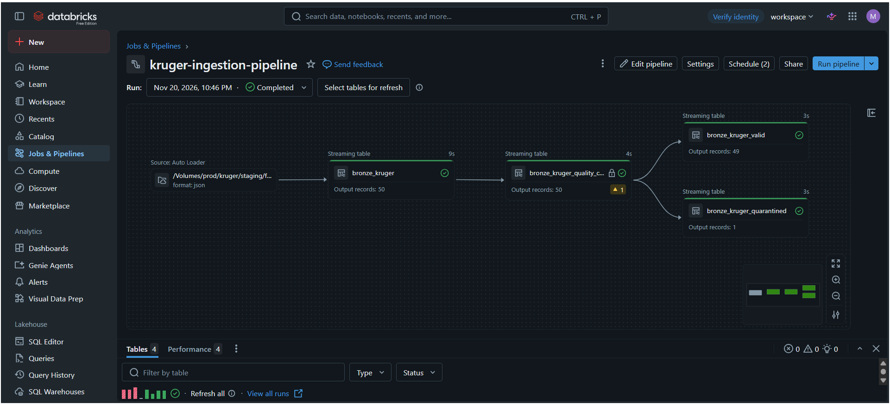
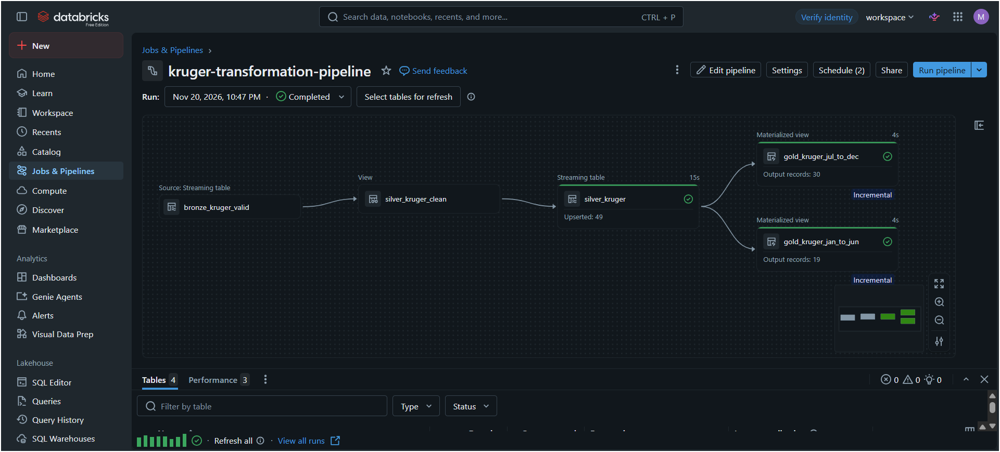
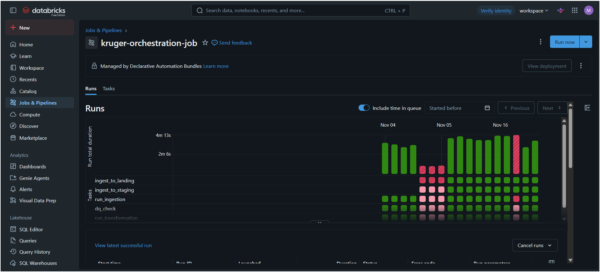
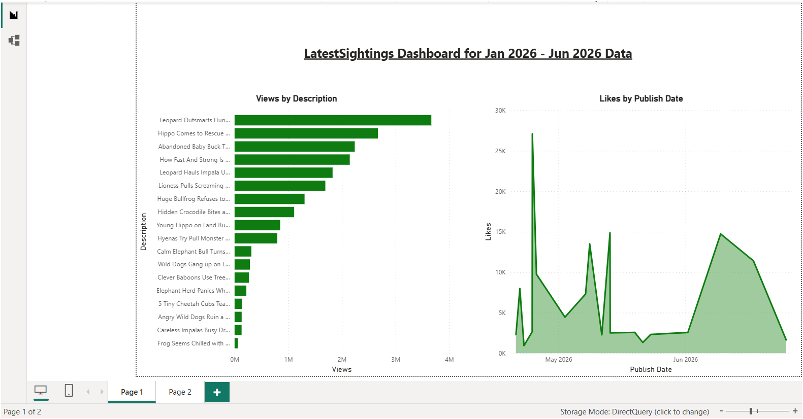
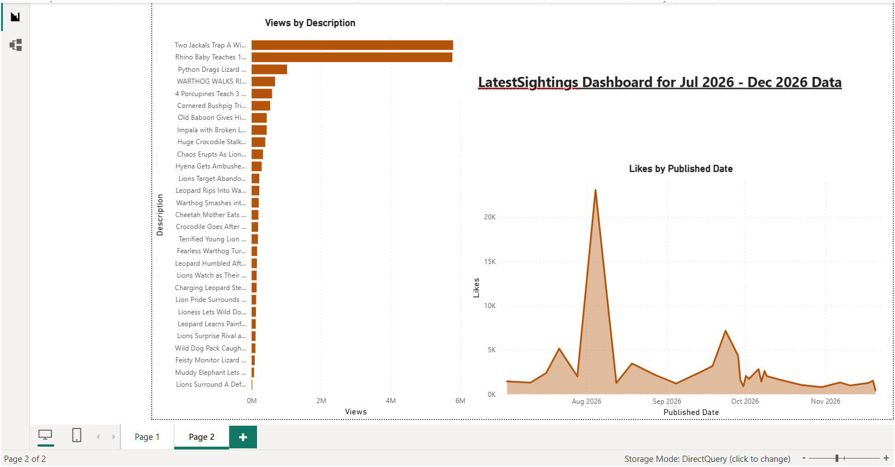
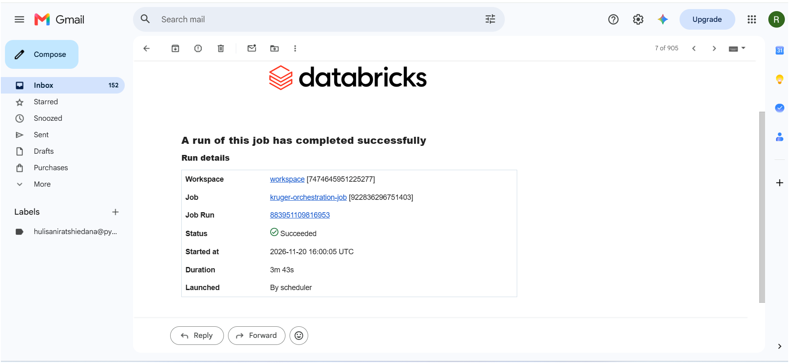

# Kruger National Park Latest Sightings Data Pipeline

An end-to-end data platform built on **Databricks Delta Live Tables (DLT)** and orchestrations using the **Medallion Architecture**.
This project pull data like (viewcount, likecount, commentcount) from a youtube channel called LatestSightings.

---

### Data Flow Breakdown
1. **Staging / Ingestion:** Raw JSON strings are continually written to Unity Catalog Volumes from upstream YouTube data harvesting engines.
2. **Bronze Layer (`bronze_kruger`):** Establishes an explicit string-based catalog schema tracking metrics (`view_count`, `comment_count`, etc.) and appends processing audit metadata (`_ingested_at`, `_source_file`).
3. **Data Quality Quarantine:** Isolates records using declarative business rules. Bad records (e.g., live feeds or missing IDs) route to `bronze_kruger_quarantined`, while clean data routes to `bronze_kruger_valid`.

4. **Silver Layer (`silver_kruger`):** Drops temporary debugging flags, enforces data type casting, converts metrics into `long` integers, and structures `published_at` fields into true `timestamp` rows.
5. **Gold Layer:** Semi-annually divides the clean operational tracking data into optimized, BI-ready materialized views separated by half-year publication cycles (**H1: January–June** vs. **H2: July–December**).

6. **Orchestration:** Job for orchestrating pipeline from ingesting data to landing zone, staging zone, bronze, silver, gold, data quality and report.

7. **Bootstrap Job:** Job for orchestrating pipeline for alert hooks, dashboard, ingestion and trsnsformation.

---

## Project Directory Tree

```text
kruger-sightings/
├── .github/
│   └── workflows/
├── bundle/
│   ├── .databricks/
│   ├── resources/
│   └── databricks.yml
├── batch_01/
│   └── filtered_youtube/
├── jobs/
├── monitoring/
├── pipelines/
│   ├── ingestion_pipeline/
│   │   ├── tests/
│   │   ├── transformations/
│   │   └── utilities/
│   └── transformation_pipeline/
│       ├── tests/
│       ├── transformations/
│       └── utilities/
├── setup/
├── tests/
│   ├── integration/
│   └── smoke/
├── README.md
├── data_generator.py
└── requirements.txt

```

---

### PowerBI Dashboard Analysis




## Data Quality Rule Framework

The pipeline guards data reliability by verifying all inbound files against explicit `KRUGER_RULES`:

```python
KRUGER_RULES = {
    "valid_id": "id IS NOT NULL",
    "valid_content": "live_broadcast_content NOT IN ('live')"
}
```

* **`bronze_kruger_valid`:** Captures every record passing all conditions.
* **`bronze_kruger_quarantined`:** Automatically traps records where `id` is missing or the video corresponds to an active stream (`live_broadcast_content == 'live'`), preventing pollution of downstream analytics.

### Email Notification on failure and success


---

## Testing Lifecycle Framework

Testing is split into two specialized methodologies within the repository:

### 1. Isolated Logic Units (`test_bronze.py`, `test_gold.py`)
These tests run instantly by reusing the existing Databricks runtime context without requiring external data files or spinning up large clusters. They evaluate code logic blocks locally:
* Validates that the programmatic expression generator strings wrap rules inside a `NOT( ... AND ... )` SQL execution constraint safely.
* Mocks temporal data elements across edge-case dates (e.g., June 30 vs. July 1) to confirm that seasonal splitting code distributes rows flawlessly.

### 2. End-to-End Integration Tests (`test_integration.py`)
A true infrastructure-integrated check that tests all system mechanics together:
1. Calls `data_generator.py` locally via an internal subprocess to create 15 fresh, realistic animal sightings records.
2. Interacts with the `WorkspaceClient` API to upload the file to your active Unity Catalog staging volume (`/Volumes/uat/kruger/staging/filtered_youtube/`).
3. Dispatches an API run command to trigger the master Databricks Orchestration Job (`run_now`).
4. Blocks execution while monitoring cloud components as they process the data.
5. Connects via the SQL Statement API to verify your table volume grows by exactly 15 records.

---
